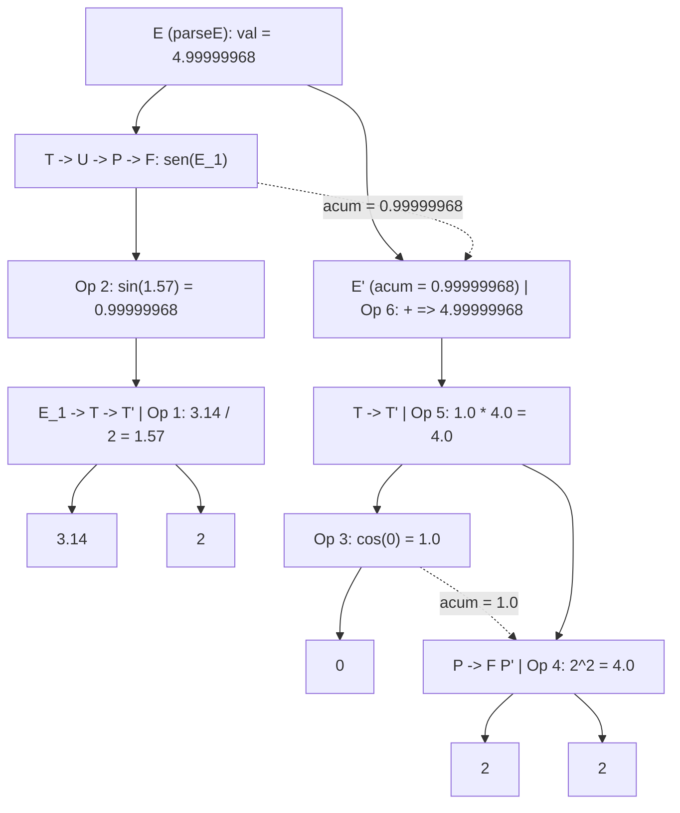

# Gramática LL(1), Primeros, Siguientes y Conjuntos de Selección

Documento de respaldo para la verificación formal LL(1) de la gramática implementada en `src/parser/trig_parser.cpp`.

## 1. Gramática con Atributos (Sintéticos `↑` y Heredados `↓`)

- **Atributos Sintéticos (`↑`):** se mueven de abajo hacia arriba en el árbol de derivación, y en las producciones de derecha a izquierda.
- **Atributos Heredados (`↓`):** se mueven de izquierda a derecha en el mismo nivel del árbol de derivación, o de arriba hacia abajo. En `<E'>_{p↓, q↑}`, `<T'>_{p↓, q↑}` y `<P'>_{p↓, q↑}`, `p` es el atributo heredado (acumulado) y `q` el atributo sintético (resultado final).

```text
(1)  <E>_p          -> <T>_q <E'>_{t↓, r↑}            t = q ; p = r
(2)  <E'>_{p↓, q↑}  -> + <T>_r <E'>_{s↓, t↑}          s = p + r ; q = t
(3)  <E'>_{p↓, q↑}  -> - <T>_r <E'>_{s↓, t↑}          s = p - r ; q = t
(4)  <E'>_{p↓, q↑}  -> λ                              q = p

(5)  <T>_p          -> <U>_q <T'>_{t↓, r↑}            t = q ; p = r
(6)  <T'>_{p↓, q↑}  -> * <U>_r <T'>_{s↓, t↑}          s = p * r ; q = t
(7)  <T'>_{p↓, q↑}  -> / <U>_r <T'>_{s↓, t↑}          s = p / r ; q = t   (r ≠ 0)
(8)  <T'>_{p↓, q↑}  -> λ                              q = p

(9)  <U>_p          -> + <U>_q                        p = q
(10) <U>_p          -> - <U>_q                        p = -q
(11) <U>_p          -> <P>_q                          p = q

(12) <P>_p          -> <F>_q <P'>_{t↓, r↑}            t = q ; p = r
(13) <P'>_{p↓, q↑}  -> ^ <U>_r                        q = p ^ r
(14) <P'>_{p↓, q↑}  -> λ                              q = p

(15) <F>_p          -> ( <E>_q )                      p = q
(16) <F>_p          -> FUNC ( <E>_q )                 p = FUNC(q)
(17) <F>_p          -> NUM_q                          p = q
(18) <F>_p          -> VAR_q                          p = q
```

## 2. Gramática Subyacente (Sin Acciones)

```text
(1)  E  -> T E'
(2)  E' -> + T E'
(3)  E' -> - T E'
(4)  E' -> ε

(5)  T  -> U T'
(6)  T' -> * U T'
(7)  T' -> / U T'
(8)  T' -> ε

(9)  U  -> + U
(10) U  -> - U
(11) U  -> P

(12) P  -> F P'
(13) P' -> ^ U
(14) P' -> ε

(15) F  -> ( E )
(16) F  -> FUNC ( E )
(17) F  -> NUM
(18) F  -> VAR
```

## 3. Anulables, PRIMEROS (`FIRST`) y SIGUIENTES (`FOLLOW`) por No Terminal

- **No terminales anulables:** `Nonul = { E', T', P' }`
- **Producciones anulables:** `Panul = { 4, 8, 14 }`

| No terminal | `FIRST` (Primeros) | `FOLLOW` (Siguientes) |
|---|---|---|
| `E` | `{ +, -, (, FUNC, NUM, VAR }` | `{ $, ) }` |
| `E'` | `{ +, -, ε }` | `{ $, ) }` |
| `T` | `{ +, -, (, FUNC, NUM, VAR }` | `{ +, -, $, ) }` |
| `T'` | `{ *, /, ε }` | `{ +, -, $, ) }` |
| `U` | `{ +, -, (, FUNC, NUM, VAR }` | `{ *, /, +, -, $, ) }` |
| `P` | `{ (, FUNC, NUM, VAR }` | `{ *, /, +, -, $, ) }` |
| `P'` | `{ ^, ε }` | `{ *, /, +, -, $, ) }` |
| `F` | `{ (, FUNC, NUM, VAR }` | `{ ^, *, /, +, -, $, ) }` |

## 4. PRIMEROS y Conjuntos de SELECCIÓN (`SELECT`) por Producción

Regla de cálculo:
- Si `ε ∉ FIRST(α)`: `SELECCIÓN(A -> α) = FIRST(α)`
- Si `ε ∈ FIRST(α)`: `SELECCIÓN(A -> α) = (FIRST(α) \ {ε}) ∪ FOLLOW(A)`

| # | Producción (`A -> α`) | `FIRST(α)` | `SELECCIÓN(A -> α)` |
|---|---|---|---|
| 1 | `E -> T E'` | `{ +, -, (, FUNC, NUM, VAR }` | `{ +, -, (, FUNC, NUM, VAR }` |
| 2 | `E' -> + T E'` | `{ + }` | `{ + }` |
| 3 | `E' -> - T E'` | `{ - }` | `{ - }` |
| 4 | `E' -> ε` | `{ ε }` | `{ $, ) }` |
| 5 | `T -> U T'` | `{ +, -, (, FUNC, NUM, VAR }` | `{ +, -, (, FUNC, NUM, VAR }` |
| 6 | `T' -> * U T'` | `{ * }` | `{ * }` |
| 7 | `T' -> / U T'` | `{ / }` | `{ / }` |
| 8 | `T' -> ε` | `{ ε }` | `{ +, -, $, ) }` |
| 9 | `U -> + U` | `{ + }` | `{ + }` |
| 10 | `U -> - U` | `{ - }` | `{ - }` |
| 11 | `U -> P` | `{ (, FUNC, NUM, VAR }` | `{ (, FUNC, NUM, VAR }` |
| 12 | `P -> F P'` | `{ (, FUNC, NUM, VAR }` | `{ (, FUNC, NUM, VAR }` |
| 13 | `P' -> ^ U` | `{ ^ }` | `{ ^ }` |
| 14 | `P' -> ε` | `{ ε }` | `{ *, /, +, -, $, ) }` |
| 15 | `F -> ( E )` | `{ ( }` | `{ ( }` |
| 16 | `F -> FUNC ( E )` | `{ FUNC }` | `{ FUNC }` |
| 17 | `F -> NUM` | `{ NUM }` | `{ NUM }` |
| 18 | `F -> VAR` | `{ VAR }` | `{ VAR }` |

## 5. Verificación Formal de la Condición LL(1)

Una gramática es **LL(1)** si y solo si para todo no terminal `A` con producciones distintas `A -> α_i` y `A -> α_j` (`i ≠ j`), sus conjuntos de selección son disjuntos (`SELECCIÓN(A -> α_i) ∩ SELECCIÓN(A -> α_j) = ∅`):

- **`E'`** (prod. 2, 3, 4):
  `{ + } ∩ { - } = ∅`, `{ + } ∩ { $, ) } = ∅`, `{ - } ∩ { $, ) } = ∅` -> **Disjuntos**
- **`T'`** (prod. 6, 7, 8):
  `{ * } ∩ { / } = ∅`, `{ * } ∩ { +, -, $, ) } = ∅`, `{ / } ∩ { +, -, $, ) } = ∅` -> **Disjuntos**
- **`U`** (prod. 9, 10, 11):
  `{ + } ∩ { - } = ∅`, `{ + } ∩ { (, FUNC, NUM, VAR } = ∅`, `{ - } ∩ { (, FUNC, NUM, VAR } = ∅` -> **Disjuntos**
- **`P'`** (prod. 13, 14):
  `{ ^ } ∩ { *, /, +, -, $, ) } = ∅` -> **Disjuntos**
- **`F`** (prod. 15, 16, 17, 18):
  `{ ( }`, `{ FUNC }`, `{ NUM }`, `{ VAR }` son todos singulares distintos -> **Disjuntos**
- **`E`, `T`, `P`**: tienen una única producción cada uno.

**Conclusión:** Ninguna pareja de producciones del mismo no terminal comparte terminales en su conjunto de selección; por lo tanto, **la gramática es estrictamente LL(1)**.

## 6. Momento de las Operaciones en el Parser Descendente Recursivo

El evaluador usa un atributo sintetizado (`double` retornado por cada `parse*`) y un atributo heredado (`acum` o `base` pasado a `parseEPrima`, `parseTPrima` y `parsePPrima`):

1. **`NUM` / `VAR` (`parseF`):** al consumir el token.
2. **`sin` / `sen` / `cos` / `tan` (`parseFuncion`):** justo al retornar de `parseE()` para el argumento y consumir `)`.
3. **Unario `-` (`parseU`):** al retornar de la llamada recursiva `parseU()` (por eso `-2^2 = -(2^2) = -4`).
4. **Potencia `^` (`parsePPrima`):** después de evaluar todo el exponente con `parseU()` (asociatividad derecha: `2^3^2 = 512`).
5. **`*`, `/`, `+`, `-` (`parseTPrima`, `parseEPrima`):** apenas retorna el operando derecho, antes de la recursión de cola (asociatividad izquierda).

### Ejemplo paso a paso: `sen(3.14 / 2) + cos(0) * 2^2`

1. `[Op 1]` en `parseTPrima(3.14)`: `3.14 / 2.0 = 1.57`
2. `[Op 2]` en `parseFuncion(sen)`: `sin(1.57) = 0.99999968293183`
3. `[Op 3]` en `parseFuncion(cos)`: `cos(0.0) = 1.0`
4. `[Op 4]` en `parsePPrima(2.0)`: `2.0 ^ 2.0 = 4.0`
5. `[Op 5]` en `parseTPrima(1.0)`: `1.0 * 4.0 = 4.0`
6. `[Op 6]` en `parseEPrima(0.99999968293183)`: `0.99999968293183 + 4.0 = 4.99999968293183`


